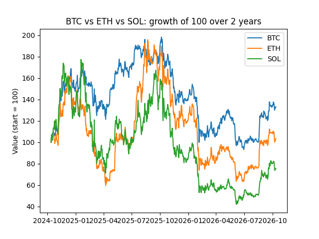

# Crypto Risk and Return Analysis

Which coin was riskier, and which gave better returns over 2 years?

## Data
Daily prices of BTC, ETH and SOL (Oct 2024 to Oct 2026) from the Binance public API. 730 days per coin.

## Tools
Python (pandas, requests, matplotlib), SQLite, SQL

## What I did
1. Downloaded the price data with Python (fetch_data.py)
2. Loaded it into a SQLite database (load_db.py)
3. Answered questions with SQL (queries.sql)
4. Measured risk and return with pandas (analysis.py)
5. Drew a growth chart (chart.py)

## Findings
| Coin | Risk (daily std %) | Total return |
|------|--------------------|--------------|
| BTC  | 2.32               | +32.88%      |
| ETH  | 3.63               | +3.40%       |
| SOL  | 4.02               | -24.32%      |

Bitcoin had the lowest risk and the best return. More risk did not mean more reward in this period.

## How to run
pip install pandas requests matplotlib
python3 fetch_data.py
python3 load_db.py
python3 analysis.py
python3 chart.py